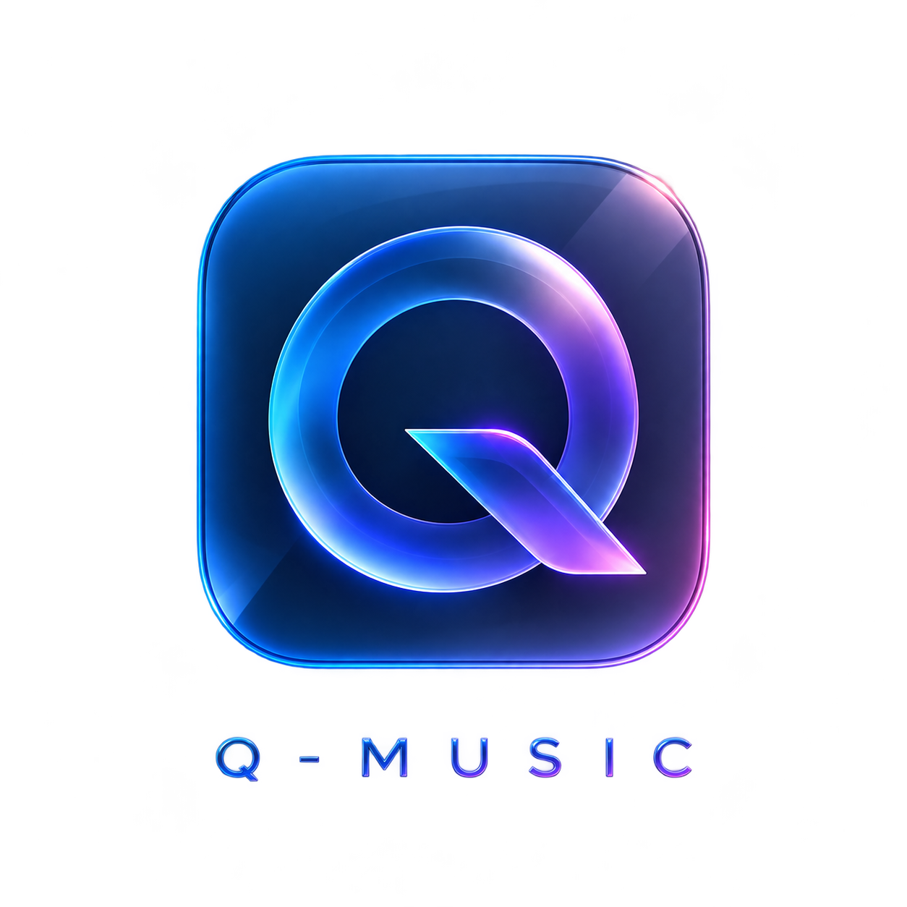

# Q-Music

<p align="center">
  
</p>

<p align="center">
  <strong>A desktop music player that gets out of your way.</strong><br>
  Built for people who own their music.
</p>

<p align="center">
  <a href="https://github.com/beast-ofcourse/q-music/releases/tag/v0.1.0">
    
  </a>
  <a href="https://github.com/beast-ofcourse/q-music/actions">
    
  </a>
  
  
  
  <a href="https://github.com/beast-ofcourse/q-music/blob/master/LICENSE">
    
  </a>
</p>

---

## Why Q-Music?

I built Q-Music because every local music player I tried either handled three formats, demanded a streaming account, or felt like a utility from 2005. I wanted something that opens fast, plays anything I throw at it, and gets out of the way.

The whole listening path — scan, index, decode, output, tag write, lyric sync — is one native Rust engine. No browser transcoding, no server dependency, no account. Just your files, played well.

## What It Does

- **Plays everything** — FLAC, MP3, M4A/AAC, ALAC, WAV, OGG, Opus, AIFF. No conversions needed.
- **Gapless playback** — sample-accurate transitions between tracks
- **Real equalizer** — 10-band, not a preset dropdown
- **Lyrics** — embedded tags, sidecar `.lrc` files, or type them yourself with timing
- **Smart playlists** — rule-based, not just manual lists
- **Fast search** — instant across a 100k-track library
- **Extensions** — plug in metadata, search, and download providers (Mornye-compatible)
- **Lightweight** — opens in seconds, stays small in memory

## Screenshots

<p align="center">
  
</p>
<p align="center">
  <em>Library view — idle state</em>
</p>

<p align="center">
  
</p>
<p align="center">
  <em>Library view — playing a track</em>
</p>

<p align="center">
  
</p>
<p align="center">
  <em>Search with provider results</em>
</p>

## Architecture

```
┌─────────────────────────────────────────────┐
│         Frontend (React 19 + Tauri)         │
│  Views · Components · State · IPC           │
├─────────────────────────────────────────────┤
│         Tauri Shell (Rust)                  │
│  Commands · State · OS Media Controls       │
├────────────────────┬────────────────────────┤
│   qcore (Rust)     │   qext (Rust)          │
│   Audio engine     │   Extension host       │
│   Library index    │   QuickJS sandbox      │
│   Tag read/write   │   Provider registry    │
│   LRC parser       │   Download queue       │
└────────────────────┴────────────────────────┘
```

**Rust owns everything that touches audio.** The webview only paints pixels and sends commands. No sample buffers cross the IPC boundary.

## Tech Stack

| Layer | Technology |
|-------|-----------|
| Audio decode | [Symphonia](https://github.com/pdeljanov/Symphonia) 0.6.1 |
| Audio output | [CPAL](https://github.com/RustAudio/cpal) 0.18.2 |
| Tags/metadata | [Lofty](https://github.com/Serial-ATA/lofty-rs) 0.25.5 |
| Database | [rusqlite](https://github.com/rusqlite/rusqlite) 0.41.1 |
| Desktop shell | [Tauri](https://tauri.app/) 2 |
| Frontend | React 19 + TypeScript + Vite 8 |
| Extension runtime | [QuickJS](https://bellard.org/quickjs/) (rquickjs 0.14) |
| HTTP client | [ureq](https://github.com/algesten/ureq) 3.5 |

## Getting Started

### Prerequisites

- Rust 1.85+ (`rustup`)
- Node.js 22+ (`npm`)
- Tauri CLI

### Development

```bash
# Clone
git clone https://github.com/beast-ofcourse/q-music.git
cd q-music

# Install frontend deps
npm install

# Run in dev mode (frontend + Rust, hot reload)
npm run tauri dev
```

### Browser-Only Mode

For UI work without the Rust backend:

```bash
npm run dev
```

Opens at `http://localhost:5173` with a demo backend and synthetic data.

### Building

```bash
npm run tauri build
# Output: src-tauri/target/release/bundle/
```

## Testing

```bash
# Rust — extension host (267 tests)
cargo test -p qext --manifest-path crates/qext/Cargo.toml

# Rust — extension host with real packages (6 tests)
cargo test -p qext --manifest-path crates/qext/Cargo.toml --features real-packages

# Rust — audio engine (49 tests)
cargo test -p qcore --manifest-path crates/qcore/Cargo.toml

# Frontend — type check
npx tsc --noEmit

# Frontend — build
npx vite build
```

## Extensions

Q-Music supports Mornye-compatible extension packages (`.sflx`). Extensions provide metadata, search, lyrics, and download capabilities from music services.

**Supported out of the box:**
- Spotify Web, Apple Music, Bugs Music, Melon Music, Genie Music (metadata + search + lyrics)
- Amazon Music, Tidal, SoundCloud, Deezer, Qobuz, JioSaavn, YouTube Music (metadata + download)

**Install an extension:**
1. Open Extensions view
2. Click "Install from file..."
3. Select a `.sflx` or `.spotiflac-ext` file from the `extensions/` folder

See [EXTENSIONS.md](EXTENSIONS.md) for the full compatibility matrix.

## Documentation

| Document | Description |
|----------|-------------|
| [docs/architecture.md](docs/architecture.md) | System architecture and design decisions |
| [docs/development.md](docs/development.md) | Developer guide and coding conventions |
| [docs/extension-development.md](docs/extension-development.md) | How to build extensions |
| [EXTENSIONS.md](EXTENSIONS.md) | Extension compatibility matrix |
| [SECURITY.md](SECURITY.md) | Security model and threat analysis |
| [DESIGN.md](DESIGN.md) | Design system specification |

## Contributing

1. Fork the repository
2. Create a feature branch
3. Make your changes
4. Run the test suite
5. Submit a pull request

## License

This project is licensed under the MIT License. See [LICENSE](LICENSE) for details.

---

<p align="center">
  <em>Built with Rust, Tauri, and a lot of late nights.</em>
</p>